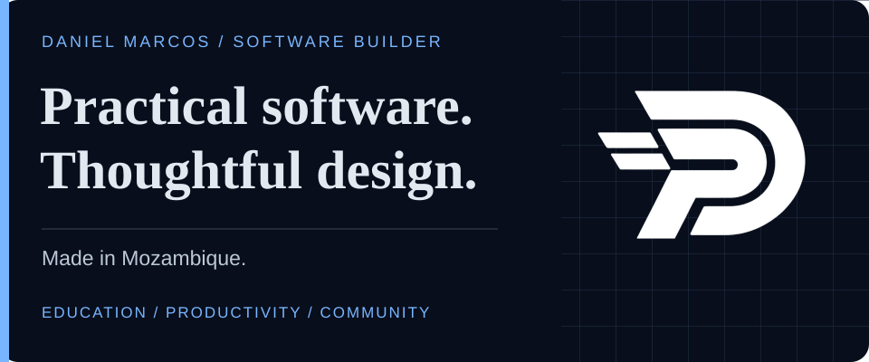
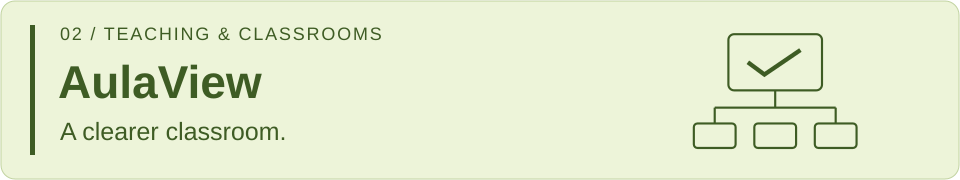
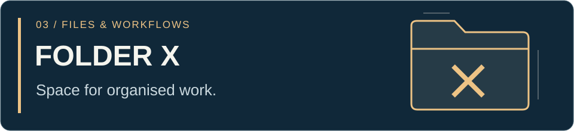

  

  <strong>IT consultant & software builder · Maputo, Mozambique</strong> 
  Web platforms, desktop tools and learning experiences for everyday work.

  <a href="https://danielpro.dev"><strong>Explore my portfolio ↗</strong></a> ·
  <a href="mailto:danielmarcos173@gmail.com">Get in touch</a> ·
  <a href="#em-português">Em português</a>

## Built around real needs

I build practical software for education, business and community life: tools that make learning more interactive, workflows clearer and everyday tasks easier.

### Explore the work

#### 🧪 [SimLab](https://simlab.danielpro.dev)
**An interactive space for science and discovery.** Explore physics, chemistry and mathematics through simulations, with desktop downloads for Windows and Linux.

[Visit SimLab ↗](https://simlab.danielpro.dev) · [Website source](https://github.com/danielcodemoz/simlab-site)

#### 🖥️ [AulaView](https://aulaview.danielpro.dev)
**A teacher’s console for the computer lab.** A Windows classroom tool, presented through a bilingual product website.

[Explore AulaView ↗](https://aulaview.danielpro.dev) · [Website source](https://github.com/danielcodemoz/aulaview-site)

#### 📂 [FOLDER X](https://folderx.danielpro.dev)
**Less file chaos. More organised work.** A Windows desktop utility for folder templates, sorting and batch operations.

[Explore FOLDER X ↗](https://folderx.danielpro.dev) · [Website source](https://github.com/danielcodemoz/folderx-site)

#### 📓 [Monolog](https://monolog.danielpro.dev)
**A journal that stays on your computer.** A local Windows app for writing, notes, habits and tasks.

[Explore Monolog ↗](https://monolog.danielpro.dev) · [Website source](https://github.com/danielcodemoz/monolog-site)

#### [GeoTurma](https://geoturma.danielpro.dev)
Grouping classes by geographic proximity.

[Explore GeoTurma ↗](https://geoturma.danielpro.dev)

#### [GuestFlow](https://guestflow.danielpro.dev)
Event guests and protocol management.

[Explore GuestFlow ↗](https://guestflow.danielpro.dev)

#### [ytDownloader](https://youtubedownloader.danielpro.dev)
Desktop media tools for content you are authorised to save.

[Explore ytDownloader ↗](https://youtubedownloader.danielpro.dev)

<strong>More products & platforms</strong>

- **[Educare Central](https://soueducare.com)** · School management and learning tools.
- **[Willow Hub](https://wiscosta.pro)** · Reservations, library and attendance workflows.
- **[Meu Prédio](https://predial.danielpro.dev)** · Condominium management for web and Android.
- **[Kazi RH](https://kazirh.danielpro.dev)** · Human-resources workflows for Mozambique.
- **[Fila Smart](https://filasmart.danielpro.dev)** · Queues and appointment scheduling.
- **[Xitique](https://xitique.danielpro.dev)** · Collective savings and rotating savings groups.

## Small experiments, useful ideas

Selected public labs, prototypes and learning tools. These are not presented as production services.

- **[PseudoCode Editor](https://github.com/danielcodemoz/PseudoCode-Editor)** · Teach algorithms with pseudocode in Portuguese.
- **[ColorGenesis](https://github.com/danielcodemoz/colorgenesis)** · Explore colour palettes for interfaces and visual identities.
- **[MozStat](https://github.com/danielcodemoz/mozstat)** · Explore indicators and open data about Mozambique.
- **[File Renamer](https://github.com/danielcodemoz/file-renamer-utility)** · Normalise filenames in batches with Python.

[Browse public repositories →](https://github.com/danielcodemoz?tab=repositories)

## My toolbox

**Web** · PHP · JavaScript · TypeScript · React · Vite 
**Desktop & mobile** · Electron · Android / Capacitor 
**Data & infrastructure** · Python / Flask · MySQL / MariaDB · Linux · nginx

Product websites and selected experiments are public here. A website repository is not necessarily the source code of the application it presents.

## Em português

Sou **Daniel Marcos**, consultor informático em Maputo. Desenvolvo plataformas web, aplicações de computador e experiências de aprendizagem para escolas, empresas e comunidades.

Procuro transformar necessidades reais em ferramentas úteis, com atenção ao funcionamento e à apresentação. Entre os projectos estão o **SimLab**, o **AulaView**, o **FOLDER X**, o **Monolog** e plataformas de gestão escolar e comunitária.

**[Conhecer os projectos ↗](https://danielpro.dev)** · **[Entrar em contacto](mailto:danielmarcos173@gmail.com)**
